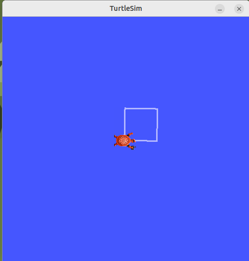
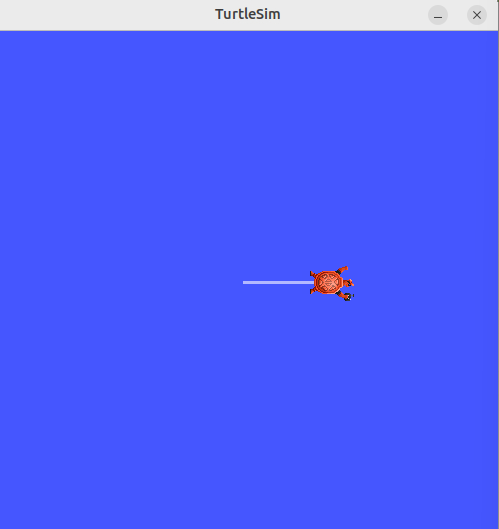
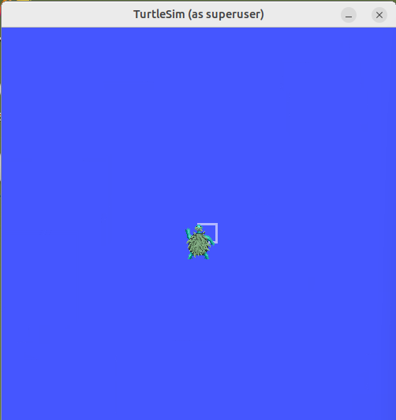
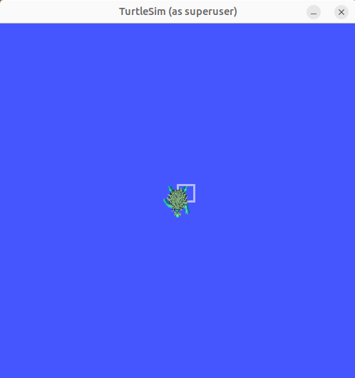
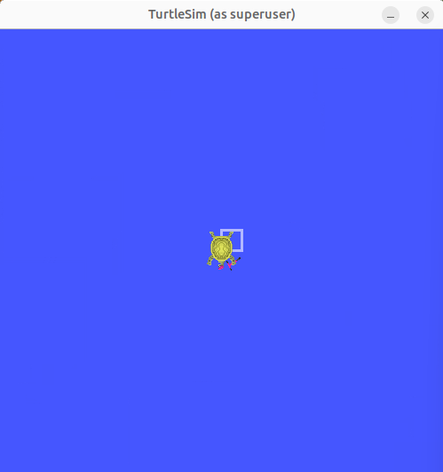

# Physical AI: LLMによるMCP経由のTurtleSim制御

## 1. 概要

本プロジェクトは、ローカルLLMとModel Context Protocol（MCP）を利用し、自然言語の指示からROS2上のTurtleSimを操作する実験です。

Windows上のLM Studioで動作する **Gemma 4 E4B** が、MCPサーバー `ros-mcp` と `rosbridge` を介してROS 2のトピックおよびアクションを呼び出し、亀に正方形を描画させることを目標としました。

主に次の2点を検証しました。

- 操作手順を人間が指定した場合、LLMが複数のMCPツールを連続実行できるか。
- 描画目標と必要なインターフェース情報を与えた場合、LLMが操作順序を計画し、追加指示なしで実行できるか。

初期の自律実行は失敗しましたが、プロンプトと実行手順を改善した結果、**1回の指示による正方形描画に成功した事例（B-5）**を得ました。ただし、単一試行の成功であり、一般的な成功率や頑健性を示すものではありません。

## 2. システム構成

```text
Windows 11
├── LM Studio
│   └── Gemma 4 E4B
├── WSL2（Ubuntu 22.04）
│   └── ros-mcp（MCPサーバー、uvx経由）
└── Docker Desktop（WSL2バックエンド）
    └── pai_ros2 コンテナ
        ├── ROS 2 Humble
        ├── rosbridge_server（WebSocket :9090）
        └── turtlesim
```

制御の流れ：

```text
自然言語の指示
  → Gemma 4 E4B（LM Studio）
  → MCPツール呼び出し
  → ros-mcp（WSL2）
  → rosbridge（WebSocket）
  → ROS 2
  → TurtleSim
```

## 3. 使用した主な技術

| 項目 | 使用技術 |
|---|---|
| OS | Windows 11 |
| Linux環境 | WSL2 / Ubuntu 22.04 |
| LLM実行環境 | LM Studio |
| LLM | Gemma 4 E4B |
| ツール連携 | Model Context Protocol（MCP） |
| MCPサーバー | ros-mcp |
| ロボットミドルウェア | ROS 2 Humble |
| ROS通信 | rosbridge_server |
| シミュレータ | TurtleSim |
| コンテナ | Docker Desktop |

## 4. 使用したROS 2インターフェース

### 4.1 直進

- MCPツール：成功した比較実験では `publish_once`
- トピック：`/turtle1/cmd_vel`
- メッセージ型：`geometry_msgs/msg/Twist`
- 主な速度指定：`linear.x = 0.5`、`angular.z = 0`

`publish_for_durations` も検討しましたが、公開時間と実際の移動量が一致するとは限らず、実験条件を統一する必要がありました。`publish_once` による1回の指令では、今回の環境で約0.504単位の直進が観測されました。これはTurtleSimの速度指令タイムアウトなどに依存するため、他環境でも同じ移動量になる保証はありません。

### 4.2 回転

- MCPツール：`send_action_goal`
- アクション：`/turtle1/rotate_absolute`
- アクション型：`turtlesim/action/RotateAbsolute`
- 目標フィールド：`theta`（ラジアン）

`rotate_absolute` の `theta` は**現在角度からの回転量ではなく、目標となる絶対方位角**です。たとえば `theta = π/2`、`π`、`-π/2` のように目標方位を順に指定します。

### 4.3 状態取得・初期化

- 位置・姿勢：`/turtle1/pose`（`turtlesim/msg/Pose`）
- 描画を含む初期化：`/reset`（`std_srvs/srv/Empty`）
- 指定位置への移動：`/turtle1/teleport_absolute`（`turtlesim/srv/TeleportAbsolute`）

比較実験では `/reset` によって開始条件を揃えました。初期位置は概ね `(5.544445, 5.544445)`、初期角度は `0` です。

## 5. 実験A：人間が操作手順を指定した正方形描画

### 目的と方法

人間が直進・回転の順序とパラメータを指定し、LLMがMCPツールを連続して実行できるか確認しました。

初期段階では直進4回・回転4回や `publish_for_durations` を含む操作を試しました。**最終的にB-5と比較した成功条件**は、`publish_once` による直進4回と `send_action_goal` による絶対回転3回、計7操作です。正方形を描いて始点に戻るだけなら、最後の4回目の回転は必須ではありません。

使用したプロンプト：[`prompts/draw_square.md`](prompts/draw_square.md)

### 結果

- 最終位置：`(5.549697399, 5.547192097)`
- 初期位置：`(5.544444561, 5.544444561)`
- 始点からの距離：約 **0.00593**（1辺約0.504に対し約 **1.18%**）
- 正方形に近い軌跡を描画できました。

初期の試行では回転ツールの引数指定エラーも経験しました。手順を与えた実験Aは、**LLMが独力で経路計画した証拠ではありません**。

### 描画結果



## 6. 実験B：操作計画をLLMに任せた正方形描画

### 6.1 目的

「正方形を描く」という目標から、LLMが操作の計画とMCPツールの呼び出しを行えるかを調べました。実験を通じて、ツール仕様・操作回数・絶対角度・実際のツール実行の区別をプロンプトで明確にしていきました。

### 6.2 初期の失敗記録

初期試行では、回転アクションの目標フィールドに存在しない `radians` や `angle` を指定してエラーになり、描画が停止しました。これは**ツール呼び出しの引数仕様を理解することの重要性**を示しました。



### 6.3 B-1〜B-5の改善過程

| 実験 | 主な条件・変更点 | 実行結果 | 評価 |
|---|---|---|---|
| **B-1** | 操作計画をLLMに任せる | 7操作を計画したが、実際には直進3回・回転3回の計6操作。モデルは完了と説明 | 未完了 |
| **B-2** | 操作回数の確認を強化 | 直進4回・回転3回の計7操作を呼んだが、回転目標を毎回 `-π/2` にしてしまった | 軌跡が正方形にならず |
| **B-3** | 計画とツール実行の区別を明確化 | 方位角の計画は改善したが、JSONテキストだけを出力したり、最後のツール呼び出しが実行されなかったりした | 単独実行では未完了 |
| **B-4** | B-3の途中で、人間が「実際にMCPツールを呼び出す」よう追加指示 | 計7操作を実行して正方形を描画 | 成功。ただし追加の人間指示あり |
| **B-5** | 計画→実行→確認→報告を1つのプロンプトに整理し、途中のJSON文章化を避ける | 計7操作を実行して正方形を描画 | **追加指示なしで成功（確認した1試行）** |

#### B-1：操作数の不足

7操作の計画に対して実行は6操作にとどまりました。最終位置は約 `(5.553925, 5.037715)`、始点からの距離は約 **0.507** でした。**モデルの「成功した」という説明と、実際のMCP実行履歴を分けて確認する必要**がありました。

#### B-2：絶対角度と相対角度の混同

操作数は7回になりましたが、回転アクションの目標角度をすべて `-1.5708` rad に設定しました。絶対回転なので、2回目以降は実質的に同じ方位を指示したことになります。最終位置は約 `(6.076863, 4.032712)`、始点からの距離は約 **1.603** でした。

#### B-3：計画の出力とツール実行の混同

必要な方位角の計算は改善しましたが、MCPツールを呼ぶ代わりにJSON形式の文章を出力する場面がありました。また、ツール呼び出しらしい文字列が表示されても、実際の実行結果が伴わない例がありました。**画面上の文章とツールの実行ログを区別**して評価しました。



#### B-4：人間の追加指示による成功

B-3で実行が止まった後、「実際にMCPツールを呼び出してください」と追加指示したところ、7操作が実行され正方形が描かれました。最終位置は実験Aと一致しました。ただし、途中に人間の介入があるため、**1回の指示だけでの自律実行成功とは区別**します。



#### B-5：1回のプロンプトによる成功

プロンプトを「計画→実行→確認→報告」の段階に整理し、計画のJSONテキストを出力するだけで終わらず、MCPツールを実際に呼び出すよう明示しました。直進4回と絶対回転3回、計7回のツール呼び出しが確認され、TurtleSim上に正方形が描画されました。

- 初期位置：`(5.544444561, 5.544444561)`
- 最終位置：`(5.549697399, 5.547192097)`
- 始点からの距離：約 **0.00593**
- 1辺約0.504に対する位置誤差：約 **1.18%**
- 実験AおよびB-4と同じ最終位置を観測

**注意：** この誤差は描画終了後の位置から計算したものです。今回の操作は基本的に事前に決めた指令列によるものであり、位置誤差を観測して逐次補正する閉ループ制御を実証したわけではありません。また、B-5の成功は確認できた1試行の結果で、成功率の統計的評価は行っていません。

B-5で使用したプロンプト：[`prompts/autonomous_square_b5.md`](prompts/autonomous_square_b5.md)。初期失敗実験の記録は[`prompts/autonomous_square.md`](prompts/autonomous_square.md)に保存しています。



### 6.4 実験結果の要約

| 比較項目 | 実験A | 実験B-1 | 実験B-2 | 実験B-4 | 実験B-5 |
|---|---|---|---|---|---|
| 人間による操作手順の指定 | あり | なし | なし | 途中で追加指示 | なし（初期プロンプトの制約はあり） |
| 実行された操作数 | 7 | 6 | 7 | 7 | 7 |
| 正方形描画 | 成功 | 失敗 | 失敗 | 成功 | 成功 |
| 始点からの距離（概数） | 0.00593 | 0.507 | 1.603 | 0.00593 | 0.00593 |

### 6.5 10月31日の追加実験（動画撮影）

10月30日のB-5と同じプロンプトを使用し、Gemma 4 E4BによるTurtleSimの正方形描画を再実行した。

最初の直進操作は成功したが、1回目の回転操作でMCPツール `send_action_goal` の引数解析エラーが発生した。必須引数 `action_name` の代わりに `action` を指定したことが原因である。

Gemma 4 E4Bはエラーメッセージを参照し、引数名を修正して再試行した。再試行は成功し、その後も人間の追加指示なしで操作を継続した。

正常に実行されたMCPツールは、`publish_once` が4回、`send_action_goal` が3回の計7回であった。これとは別に、引数解析に失敗した呼び出しが1回あった。

実行後、ROS 2の `/turtle1/pose` から最終位置を取得した。

- 初期位置：`(5.544444561, 5.544444561)`
- 最終位置：`(5.549697399, 5.547192097)`
- 最終方位角：`-1.579185247 rad`
- 始点への復帰距離：約 **0.00593単位**
- 辺長約0.504単位に対する復帰誤差：約 **1.18%**

今回の結果は、LLMがツール引数のエラーを認識・修正して操作を継続した一事例である。一般的なエラー回復能力や成功率を実証したものではない。

## 7. AIを使用した部分と考察

Gemma 4 E4Bを、文章生成だけでなく、MCPツールを通じたROS2操作の実行主体として利用しました。

今回の試行から、少なくとも次の課題が明らかになりました。

1. **計画と実行は異なる**：計画に7操作と書いてあっても、実際のツール呼び出しが7回とは限りません。
2. **ツール仕様の理解が重要**：`RotateAbsolute` の `theta` は絶対方位角であり、相対回転量ではありません。
3. **ツール呼び出しの検証が必要**：JSONや特殊なツール呼び出し表現が表示されても、実行成功を意味するとは限りません。
4. **プロンプトの構成が結果に影響**：計画から実行までの手順を明示したB-5では、1回の指示で描画が成功しました。
5. **制御精度とLLMの自律性は別の評価軸**：始点への復帰誤差が小さくても、フィードバック制御や高い再現性が証明されたわけではありません。

## 8. リポジトリ構成

```text
physical-ai-mcp-turtlesim/
├── README.md
├── docs/
│   ├── setup_guide.md
│   └── turtlesim_guide.md
├── scripts/
│   └── run_pai_container.sh
├── prompts/
│   ├── draw_square.md
│   ├── autonomous_square.md
│   └── autonomous_square_b5.md
└── images/
    ├── square_result.png
    └── square_failed.png
```
- [環境立ち上げマニュアル](docs/setup_guide.md)
- [TurtleSim操作マニュアル](docs/turtlesim_guide.md)

## 9. 今後の改善（案）

- 実験B-5を複数回繰り返し、成功率とばらつきを評価する。
- 各MCPツールの引数・戻り値を記録し、計画と実行の一致を自動判定する。
- `/turtle1/pose` を途中で取得し、位置・姿勢の誤差を使う閉ループ制御を検討する。
- ツール呼び出しエラー時の再計画とリカバリーを検討する。

## 10. 実験日

2026年10月29日〜31日（記録整理を含む）
